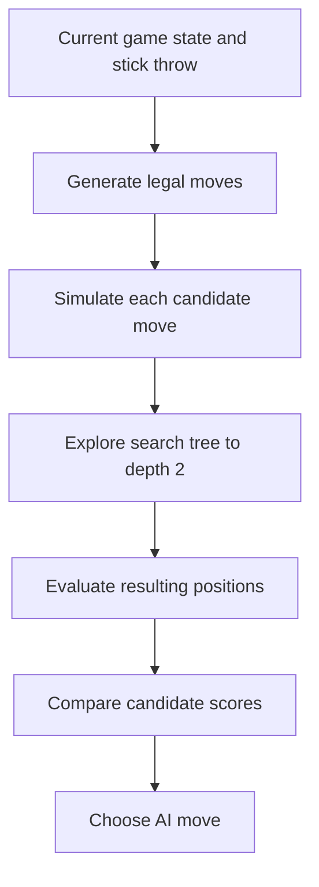

# Senet — Intelligent Search Algorithms

<p align="center">
  <strong>A Java implementation of the ancient Egyptian board game, featuring rule-based evaluation and adversarial search.</strong>
</p>

<p align="center">
  
  
  
  
</p>

## Overview

**Senet — Intelligent Search Algorithms** is a command-line implementation of **Senet**, the ancient Egyptian board game. It combines a playable two-player game with a computer-controlled opponent that explores possible moves and scores board positions using domain-specific heuristics.

The project is designed to demonstrate core ideas in **game-state modeling**, **move generation**, **adversarial search**, **probabilistic outcomes**, and **heuristic evaluation**.

## Features

- **Human vs Human:** Play against another person in the terminal.
- **Human vs AI:** Play as White against a Black AI opponent.
- **Game-state management:** Track the board, players, pieces, turns, and terminal conditions.
- **Legal-move handling:** Generate available moves and apply the game's movement rules.
- **Throw probabilities:** Model the possible stick-throw outcomes from **1 through 5**.
- **AI move selection:** Simulate candidate moves and evaluate possible continuations.
- **Strategy-based scoring:** Reward useful moves and penalize risky positions, including interactions with special houses.
- **Search diagnostics:** Print candidate-move scores and a search trace to the console.

## Getting Started

### Prerequisites

- A **Java Development Kit (JDK)** with `javac` and `java` available on your PATH. **Java 11+ is recommended** because the source uses `String.repeat()`.
- Git (optional, for cloning).

### Installation

```bash
git clone https://github.com/MohammedAbdelkarem/Senet_Intelligent_Search_Algorithms.git
cd Senet_Intelligent_Search_Algorithms
```

### Compile and Run

The project contains Java source files directly in the repository root; no Maven or Gradle configuration is included.

```bash
javac *.java
java Main
```

> **Note:** If the compilation reports an error in an auxiliary file such as `tempCodeRunnerFile.java`, compile the application classes explicitly instead. The repository has not been independently compiled as part of preparing this README.

At startup, the console presents a mode selection similar to:

```text
Choose game mode:
1) Human vs Human
2) AI vs Human (White = Human, Black = AI)
> 
```

Choose `1` or `2` and follow the prompts displayed by the game.

## How the Game Works

Senet is played on a **30-square board** arranged in three rows of ten squares. Pieces advance along the board's path, with movement determined by throwing sticks. The goal is to move your pieces through the board and ultimately remove them from play.

This implementation models special houses, movement restrictions, piece interactions, and exits in its game logic. The AI additionally considers strategically significant houses such as:

| House | Square | Strategic role in the AI |
| --- | ---: | --- |
| Happiness | 26 | An important destination that receives a high heuristic reward. |
| Water | 27 | A hazardous square the evaluation penalizes. |
| Three Truths | 28 | Considered in late-game exit decisions. |
| Re-Atum | 29 | Considered in late-game exit decisions. |
| Horus | 30 | Important to endgame movement and scoring. |

> Senet has multiple historical and modern rule reconstructions. The authoritative rules for **this project** are those encoded in `Gamelogic.java` and the related board/state classes.

## Artificial Intelligence

### Search approach

The AI is implemented primarily in [`SenetAI.java`](./SenetAI.java). For a given stick throw, it:

1. Identifies the AI player's legal moves.
2. Simulates each candidate move on a copied game state.
3. Evaluates possible continuations using a recursive search method named `expectiminimax`.
4. Scores leaf states using multiple weighted heuristics.
5. Selects the highest-scoring candidate move (with a tie-break rule).

The current search is **limited to depth 2**, and its branches distinguish maximizing (AI) and minimizing (opponent) turns. It iterates over possible stick throws and reads their probabilities from `Sticks.probabilityOfRoll()`.

**Implementation note:** The current routine uses probability-weighted scores within max/min comparisons. It should be treated as an *Expectiminimax-inspired implementation*, rather than a verified textbook expectiminimax tree with explicit chance nodes and summed expected values. Correct probabilistic aggregation is a potential area for further development.

### Heuristic evaluation

[`Strategies.java`](./Strategies.java) supplies the rule-based scoring functions. The evaluation combines signals such as:

| Heuristic | Purpose |
| --- | --- |
| Piece exits | Reward having more pieces exit than the opponent. |
| Opponent swaps | Give value to strategically useful piece interactions. |
| Target-square planning | Encourage selected approaches to square 24. |
| Happiness House | Reward reaching square 26. |
| Water House | Penalize moves that land on square 27. |
| Horus House | Evaluate important late-board movement. |
| Endgame actions | Score selected moves from squares 26, 28, and 29. |

Heuristic weights are explicitly defined in the code and can be adjusted to experiment with different play styles. One additional advancement heuristic exists in `Strategies.java` but is commented out in the currently observed `SenetAI.evaluate()` method.

### Simplified decision flow



## Project Structure

```text
Senet_Intelligent_Search_Algorithms/
├── Board.java                # Board representation
├── GameState.java            # Complete game-state snapshot
├── Gamelogic.java            # Game flow, rules, and legal moves
├── Main.java                 # CLI entry point and game-mode selection
├── MoveInfo.java             # Metadata about simulated moves
├── Piece.java                # Individual game pieces
├── Player.java               # Player state and pieces
├── PlayerColor.java          # Player-color definitions
├── SenetAI.java              # AI search and move selection
├── SpecialHouseType.java     # Special-house classifications
├── Sticks.java               # Stick throws and probabilities
├── Strategies.java           # Weighted evaluation heuristics
├── tempCodeRunnerFile.java   # Auxiliary editor-generated file
└── .gitignore
```

## Key Concepts Demonstrated

- State-space search and tree exploration
- Adversarial decision-making with MAX/MIN turns
- Stochastic game mechanics and throw probabilities
- Heuristic evaluation functions
- Deep-copy simulation to avoid mutating the live state
- Separation of game logic, data representation, and AI strategy

## Potential Improvements

Ideas for extending the project include:

- Implement explicit **chance nodes** and correct expected-value aggregation for standard Expectiminimax.
- Make search depth and AI diagnostic logging configurable.
- Add unit tests for movement rules, special houses, terminal states, and AI decisions.
- Benchmark different heuristic weight combinations and search depths.
- Add memoization or transposition caching for repeated states.
- Provide a graphical interface or board visualization.
- Adopt a standard Java project layout and build tool.

## Contributing

Contributions and suggestions are welcome. To propose a change, open an issue or submit a pull request describing the behavior being modified and how it was tested.

## Authors

Developed by:

- **[Alaa Daloo](https://github.com/AlaaDaloo)**
- **[Mohammed Abdelkarem](https://github.com/MohammedAbdelkarem)**

## License

No license file was visible in the repository at the time this README was prepared. **Unless the repository owner adds an explicit license, do not assume rights to redistribute or reuse the code.**

---

<p align="center"><em>An exploration of intelligent decision-making through one of history's oldest board games.</em></p>
